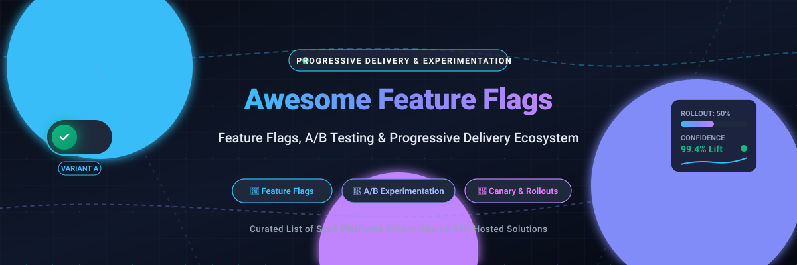

# Awesome Feature Flag Testing & Experimentation 🚩🧪

  

  
  
  
  
  

---

## 📖 Top Feature Flag Testing & Experimentation Ecosystem

> **Curated List of SaaS Platforms & Open-Source GitHub Projects**  
> *Focused on Progressive Delivery, A/B Testing, Canary Releases, Remote Configuration, & Self-Hosted Flag Management*  
> **Last updated: March 2026**

This repository tracks notable **SaaS platforms** and **open-source projects** for **Feature Flag Testing & Experimentation**. These tools empower software engineering and product teams to decouple code deployment from feature release—enabling gradual rollouts, canary deployments, instant kill switches, multivariate A/B testing, and data-driven experimentation without redeploying code.

The ecosystem spans **flag-first platforms** built for operational control and progressive delivery (LaunchDarkly, Unleash, Flagsmith, Flipt) and **experimentation-first platforms** where flags serve as the delivery pipeline for statistical metric analysis (Statsig, GrowthBook, Optimizely, PostHog).

---

## 📑 Table of Contents
- [📊 Sector Overview & Market Dynamics](#-sector-overview--market-dynamics)
- [☁️ SaaS/Hosted Platforms](#️-saashosted-platforms)
- [💻 Open-Source GitHub Projects](#-open-source-github-projects)
- [🤝 How to Contribute](#-how-to-contribute)
- [💖 Support & Sponsorship](#-support--sponsorship)
- [📈 Star History](#-star-history)
- [⚠️ Disclaimer](#️-disclaimer)

---

## 📊 Sector Overview & Market Dynamics

The global feature management and progressive delivery software market is estimated at **$350M–$375M in 2025** and projected to exceed **$550M–$630M through 2026**, expanding at a rapid compound annual growth rate (CAGR) of over 8% to 15% as continuous delivery and AI-driven feature governance accelerate.

The sector is **moderately fragmented yet increasingly consolidating**: while pioneer enterprise platforms (such as LaunchDarkly and Optimizely) and consolidated DevOps suites (like Harness acquiring Split) hold commanding enterprise market shares, agile open-source and product-led vendors (PostHog, Statsig, GrowthBook, Unleash) have driven fierce competition around warehouse-native telemetry, open standards (OpenFeature), and developer autonomy rather than winner-take-all dominance.

---

## ☁️ SaaS/Hosted Platforms

The following hosted SaaS platforms represent the category leaders in enterprise feature management, progressive rollout automation, and full-stack A/B experimentation. Sorted in descending order by company valuation / scale:

| Product | Company Size (Valuation / Revenue) | Description | Pricing (Starting) | Free Tier / Trial Limits |
|:---|:---|:---|:---|:---|
| **[Split (Harness)](https://www.split.io/)** | **$5.5B valuation** (Dec 2025 Series E, Harness) / ~$250M ARR | **Data-driven feature delivery with automated metric attribution.** Acquired by Harness in June 2024 and integrated into Harness Feature Management & Experimentation (FME). Combines flag governance with automated pipeline canary rollouts. | Team tier starting at **~$15/developer/month** (or contact sales for FME enterprise bundles) | **Free forever plan**: Up to **2 developers**, **25,000 client MAUs**, unlimited flags & environments (no credit card required) |
| **[LaunchDarkly](https://launchdarkly.com/)** | **$3.0B valuation** (Series D) / ~$60M–$100M+ ARR | **The enterprise feature management standard.** Highly scalable operational flagging infrastructure with multi-environment guardrails, instant kill switches, and client/server SDKs across every language. | Foundation tier starting at **$0 base fee** + **$10/service connection/month** pay-as-you-go | **Developer free forever tier**: **Unlimited team seats**, 5 service connections, 1,000 client-side MAUs, 1 project with 3 environments |
| **[PostHog](https://posthog.com/)** | **$1.4B valuation** (Oct 2025 Series E) / ~$55M+ ARR | **All-in-one developer platform pairing flags with product analytics and session replay.** Provides multivariate flags, instant overrides, JSON payloads, and automated A/B experimentation with confidence intervals. | Pay-as-you-go starting at **$0/month** base; **$0.0001/request** after free allocation (unlimited seats) | **Free forever tier**: **1,000,000 feature flag requests/month** free, up to 2,000 active flags, unlimited seats, no credit card required |
| **[Statsig](https://statsig.com/)** | **$1.1B valuation** (May 2025 Series C) / ~$40M ARR | **Experimentation-first platform founded by ex-Facebook infrastructure engineers.** Automatically links every flag evaluation to metric impact analysis, guardrail metrics, and statistical significance testing. | Pro tier starting at **$150/month base** (includes 5M metered events; unlimited seats; $0.05/1K overage) | **Free forever tier**: **2,000,000 metered events/month**, unlimited flag evaluations (at 0% or 100% rollout), 50,000 session replays, unlimited seats |
| **[Optimizely Feature Experimentation](https://www.optimizely.com/)** | **$400M+ ARR** (Acquired by Episerver / Insight Partners; $1.1B recapitalized) | **Enterprise full-stack experimentation and feature toggling.** Highly governed statistical engine with Bayesian and sequential testing, multi-armed bandits, and compliance workflows for global brands. | Enterprise contract starting at **~$25,000–$40,000/year** (annual billing based on MTUs/MAUs) | **Optimizely Rollouts (Free forever tier)**: Free indefinite access to basic feature flags and rollouts for unlimited team members, limited to 1 concurrent experiment rule |

---

## 💻 Open-Source GitHub Projects

Curated list of self-hosted, privacy-first, and open-source feature toggle engines, progressive deployment daemons, and statistical experimentation platforms. Sorted in descending order by GitHub star count:

| Project | Stars | Language / Stack | Description |
|:---|:---:|:---|:---|
| **[PostHog](https://github.com/posthog/posthog)** |  | Python / TypeScript | **The open-source product engineering suite.** Combines feature flags, multivariate toggles, A/B testing, session replays, and product analytics under a single open-source core. |
| **[Unleash](https://github.com/Unleash/unleash)** |  | Node.js / TypeScript / Rust | **The enterprise-grade open-source feature flag engine.** Used in high-compliance production by Visa and global enterprises. Features Unleash Edge for ultra-low latency, custom activation strategies, progressive rollouts, and multi-language SDKs. |
| **[GrowthBook](https://github.com/growthbook/growthbook)** |  | TypeScript / Next.js / Python | **The leading open-source A/B testing and experimentation engine.** Warehouse-native: directly connects to Snowflake, BigQuery, Redshift, ClickHouse, and Postgres so data never leaves your infrastructure. Includes official OpenFeature SDK providers. |
| **[Flagsmith](https://github.com/Flagsmith/flagsmith)** |  | Python / Django / React | **Deployment-flexible open-source feature flagging and remote config.** Fully self-hostable in private clouds, Kubernetes, or air-gapped on-premise environments. Offers vendor-maintained OpenFeature providers and scheduled flag rollouts. |
| **[Flipt](https://github.com/flipt-io/flipt)** |  | Go / Vue.js | **Cloud-native, GitOps-ready feature flag solution.** High-performance single-binary daemon that can run completely database-free by storing flag definitions directly in Git repositories alongside application code. |
| **[Flipper](https://github.com/flippercloud/flipper)** |  | Ruby | **The premier feature flag toolkit for Ruby on Rails.** Built by former GitHub engineers; supports actors, groups, percentage of actors, percentage of time, and multiple persistence backends (Redis, ActiveRecord, Mongo). |
| **[Flagr](https://github.com/openflagr/flagr)** |  | Go / Vue.js | **Open-source feature flagging, A/B testing, and dynamic configuration microservice.** Scalable REST and Swagger APIs delivering high-throughput evaluation and multi-variant percentage rollouts. |
| **[GO Feature Flag](https://github.com/thomaspoignant/go-feature-flag)** |  | Go | **Lightweight, configuration-as-code feature flag solution.** Evaluates flags from local or remote configuration files (YAML, JSON, S3, Git, Kubernetes ConfigMaps) with zero complex infrastructure requirements. Official OpenFeature provider. |
| **[FeatBit](https://github.com/featbit/featbit)** |  | C# / .NET / TypeScript | **High-concurrency self-hosted feature management and experimentation platform.** Engineered to handle 1M+ simultaneous online users with real-time flag synchronization, targeting rules, audit logs, and OpenTelemetry integration. |
| **[FeatureProbe](https://github.com/featureprobe/FeatureProbe)** |  | Rust / Java / React | **High-performance open-source feature management service.** Leverages Rust for microsecond-level server evaluation, real-time client synchronization, and automated progressive rollout gating. |
| **[OpenFeature Spec](https://github.com/open-feature/spec)** |  | Specification / Markdown | **The vendor-agnostic CNCF standard for feature flagging.** Provides universal interfaces, SDK abstractions, and evaluation specifications to eliminate proprietary vendor lock-in across software stacks. |
| **[Togglz](https://github.com/togglz/togglz)** |  | Java | **The standard implementation of the Feature Toggle pattern for Java applications.** Deeply integrated with Spring Boot, CDI, and Java EE, offering web consoles and multiple state repositories. |
| **[Bucketeer](https://github.com/bucketeer-io/bucketeer)** |  | Go / TypeScript | **Cloud-native feature flag and A/B testing platform created by CyberAgent.** Runs on Kubernetes with gRPC-first high performance, automated event collection, and multivariate experiment evaluation. |

---

## 🤝 How to Contribute

Contributions to this ecosystem list are warmly welcomed! 

1. 🍴 **Fork the repository** on GitHub.
2. 🌿 **Create a new branch**: `git checkout -b add-awesome-tool`
3. 📝 **Add your tool/platform**: Follow the table layout and keep descriptions concise, objective, and factual.
4. 📬 **Submit a Pull Request**: Provide a brief summary of the project and ensure star badges follow the specified social badge format.

---

## 💖 Support & Sponsorship

If you find this curated ecosystem guide helpful for your engineering workflow or architecture decisions:

- ⭐ **Star this repository** to help other engineers discover it.
- 🍴 **Fork & share** it with your developer community.
- ☕ **Sponsor the maintainer** via the [GitHub Sponsor Dashboard](https://github.com/sponsors/ishandutta2007) to keep this resource continuously maintained and updated.

---

## 📈 Star History

---

## ⚠️ Disclaimer

- This repository is a **community-curated guide** intended for informational and educational purposes; inclusion does not constitute commercial endorsement.
- Feature flags directly control live application pathways and critical runtime behavior. Always enforce defensive programming best practices: fail closed (disabled by default), isolate flag checks at interface boundaries, validate permissions server-side, and periodically clean up stale or dead toggles.
- Verify enterprise compliance needs (such as HIPAA, GDPR, SOC 2, and self-hosted air-gapped constraints) when choosing between hosted SaaS platforms and open-source self-hosted solutions.

---

  <b>Built with ❤️ for platform engineers, DevOps practitioners, and experimentation champions worldwide.</b>

